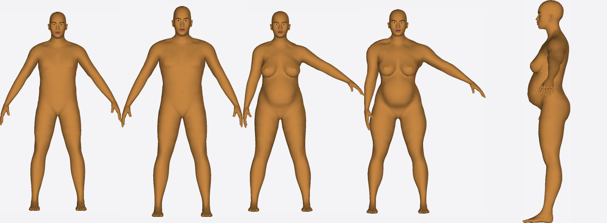

`npm run human:fit` on synthetic targets with known sliders (target → fitted):

| Target A | Fitted (front photo) | Target B | Fitted (front + side) | Fitted, side |
|---|---|---|---|---|

A: weight 0.8 / muscle 0.35 / arms 35°,30° → fitted 0.8 / 0.3 / 28°,28°. B: weight 0.85, arms 60°,15° → fitted weight 1.0, arms 58°,8°; the side photo pulls gender to 0.25 (true 0.1).
