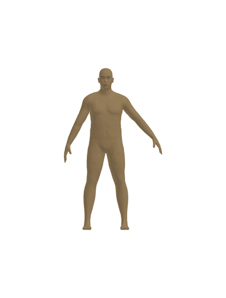
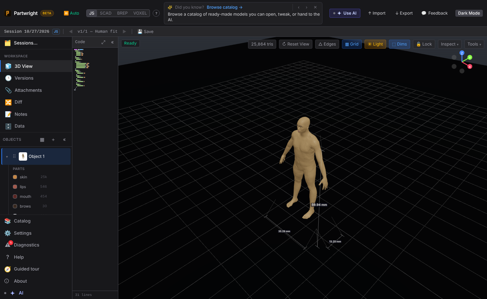
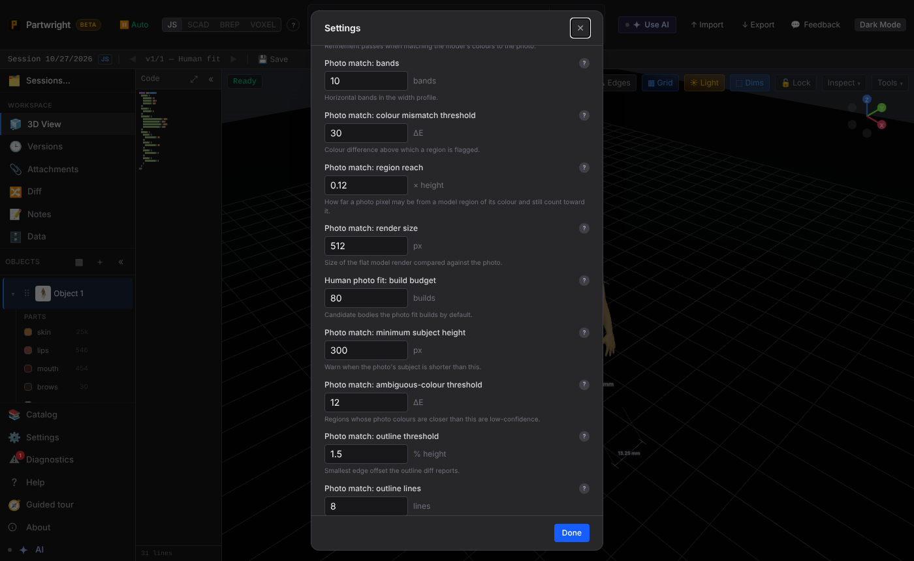

**In the app:** `partwright.fitHuman` (chat tool `fitHumanToPhoto`) fitting a default body to a "photo", a front render of a known figure (heavy, arms out). With 20 candidate builds in the engine Worker it reached a silhouette match of about 0.89 and saved version "Human fit".

| Photo | Fitted body in the editor |
|---|---|
|  |  |

The default build budget is a new Advanced Settings field:

**CLI** (`npm run human:fit`) on synthetic targets with known sliders. Left to right: target A, fit from a front photo; target B, fit from front and side photos, then that fit from the side.

