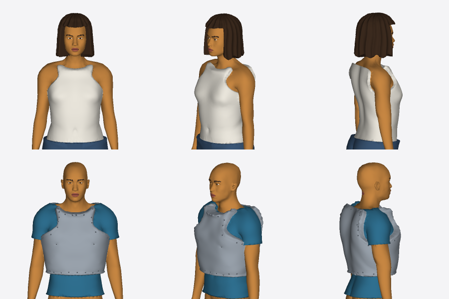
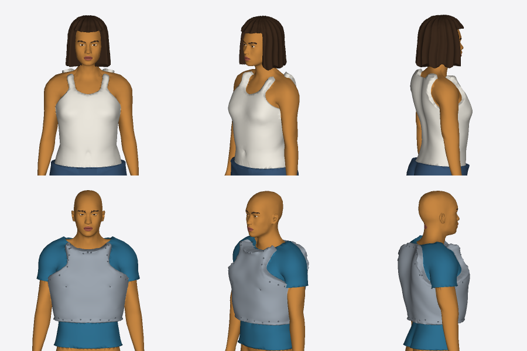
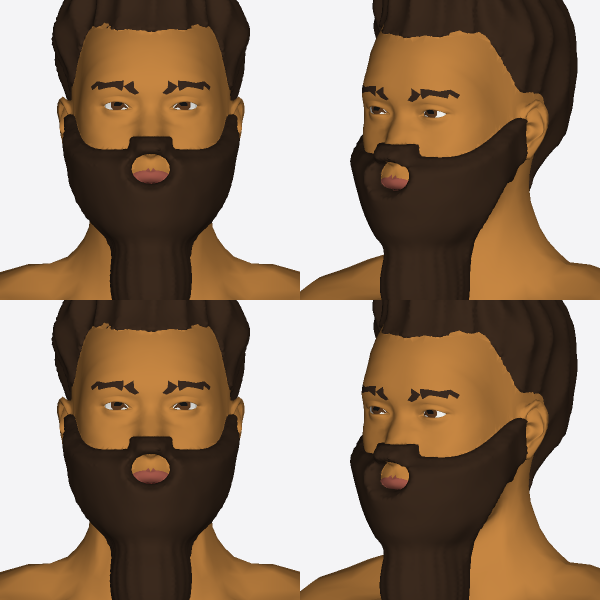
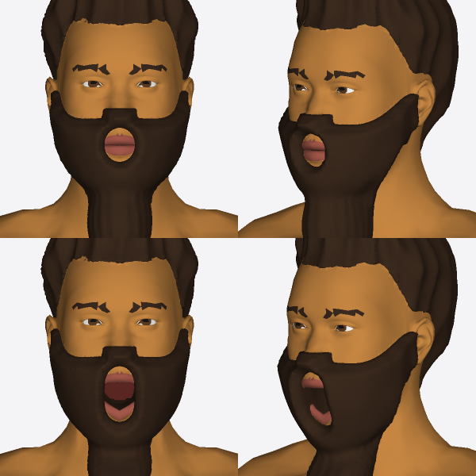
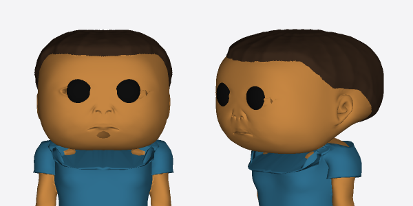
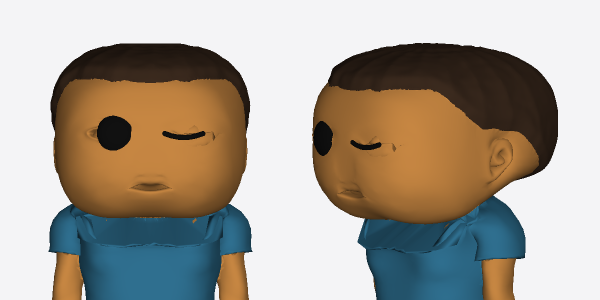
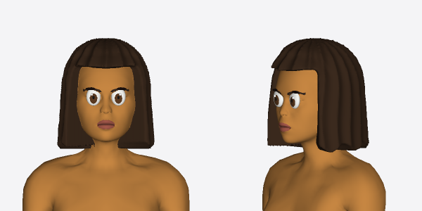
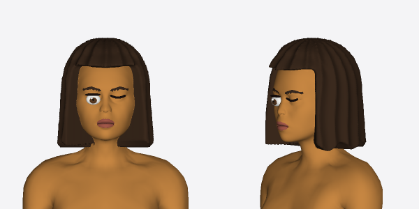

Headless renders (`model:preview`'s renderer, zoomed), before (#1167's head) and after (this PR).

**Tank tops and the cuirass.** A sleeveless top keeps straps over the shoulders, with a scoop neck; necklines run round the neck. The cuirass's top edge falls from the neck to the shoulder: no more points standing up the slope. Rows: `{ item: 'top', sleeve: 'none' }`, then a cuirass over a tshirt.

| Before | After |
|---|---|
|  |  |

**Beard and an open jaw.** The beard below the mouth rides the jaw, and the lips' bare patch is centred on the lips. Rows: jaw closed, then `jawOpen: 1`.

| Before | After |
|---|---|
|  |  |

**Toy and anime faces.** Funko: no nose, and at most a small mouth shape. `blinkL: 1` closes a sculpted eye to a lid line; `blinkR: 0.5` (anime) squashes it.

| Before | After |
|---|---|
|  |  |
|  |  |
