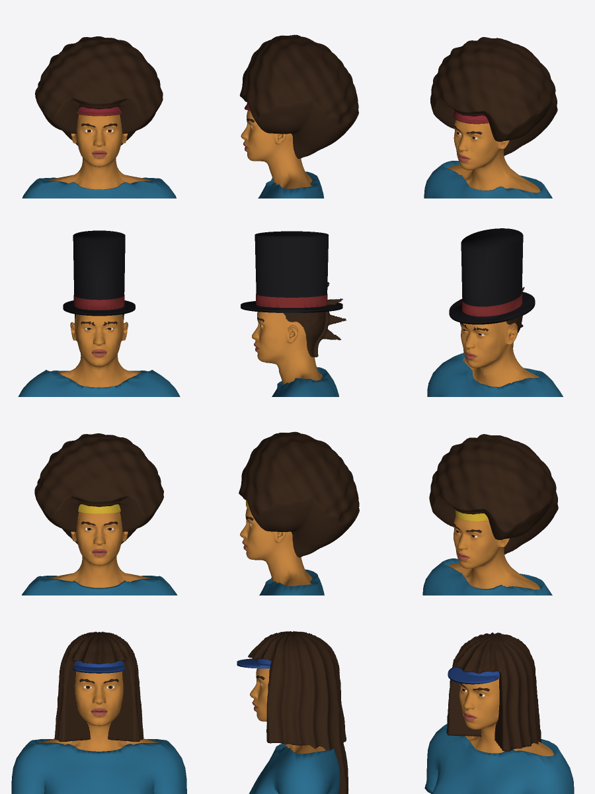
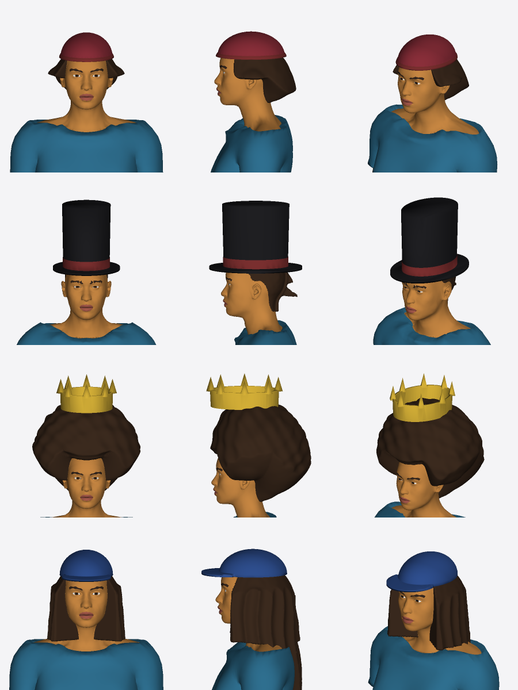
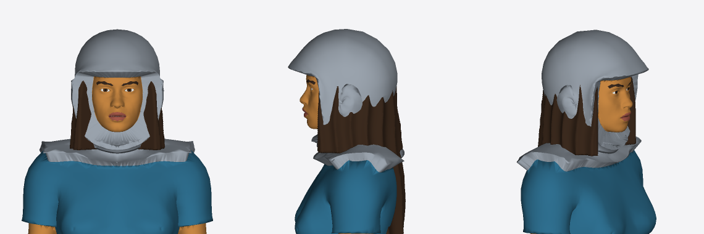
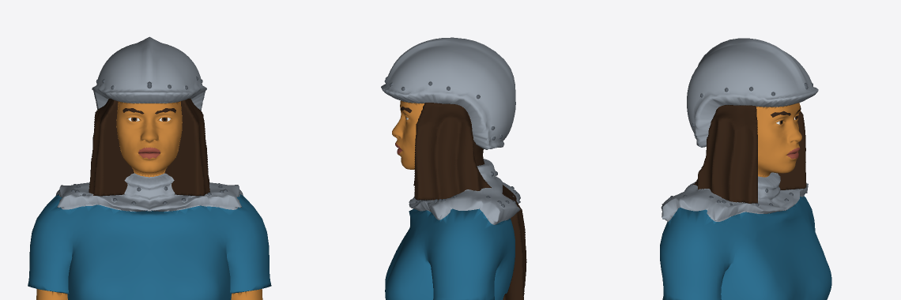
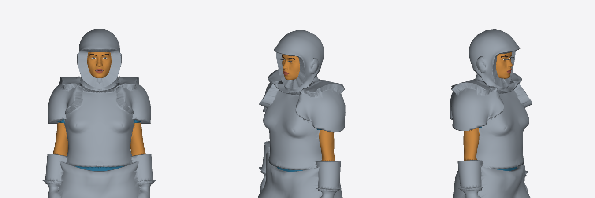
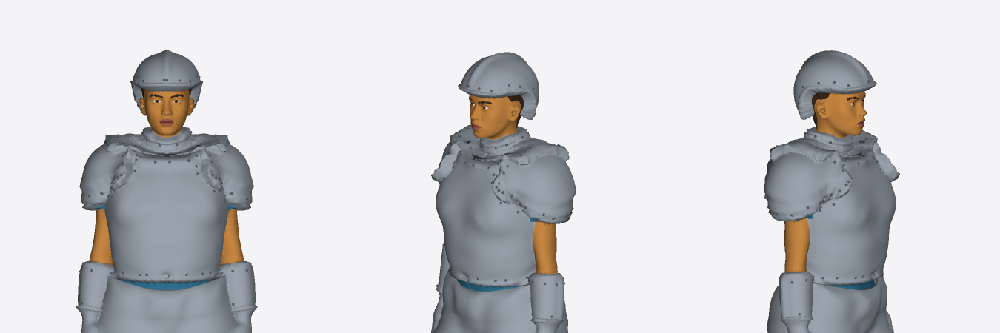
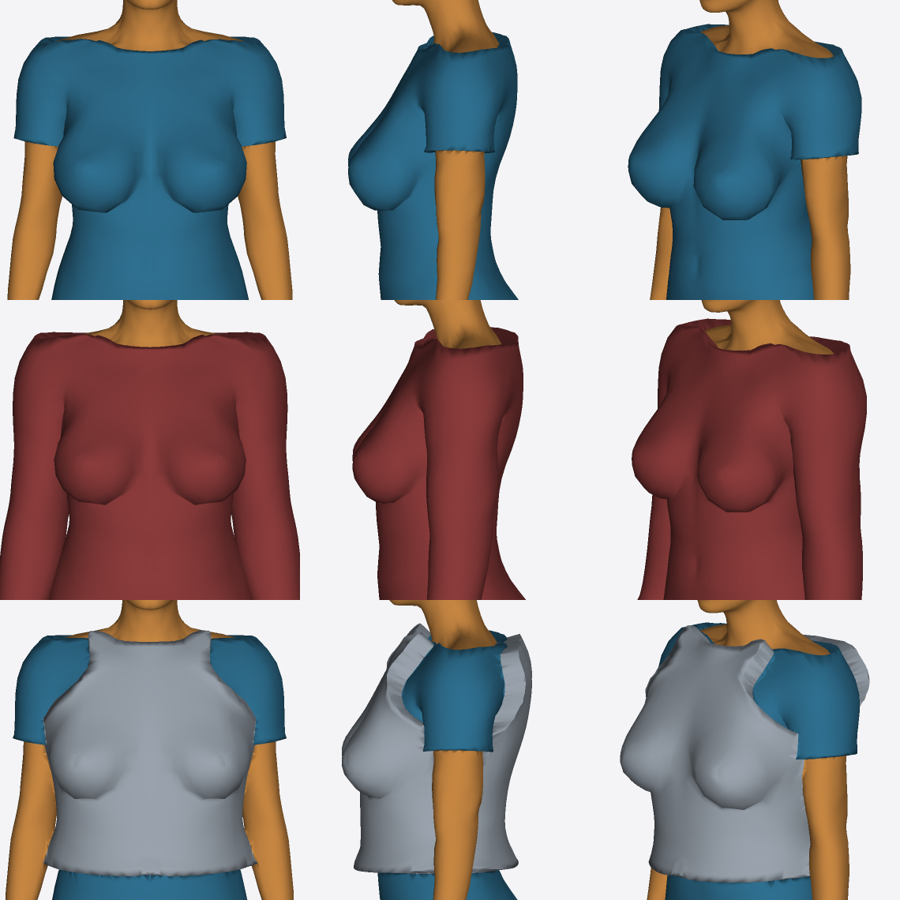
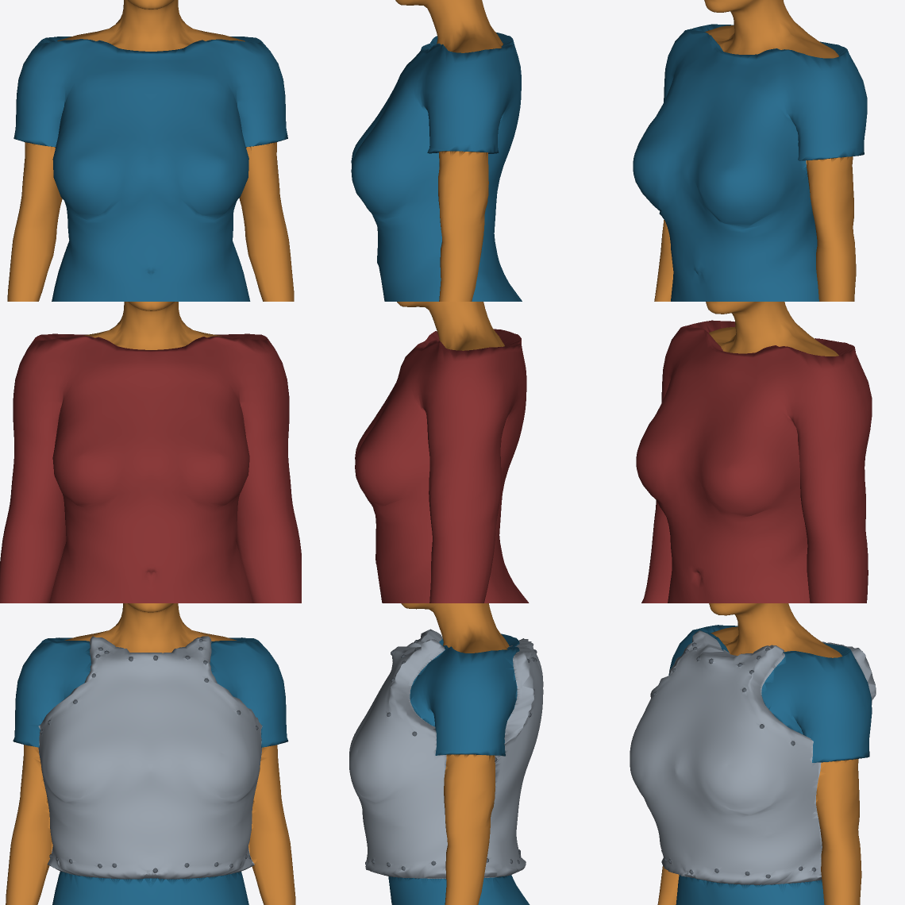

Headless renders (`model:preview`'s renderer, zoomed), before (the previous PR's head) and after (this PR).

**Headwear.** Hats press the hair flat and the hair shows under the brim; crowns sit on the hair (on top of an afro). Rows: afro + beanie, mohawk + top hat, afro + crown, long hair + cap.

| Before | After |
|---|---|
|  |  |

**Helmet.** Clear of the ears, with a nape guard, a crest, a bevelled rolled rim and rivets; long hair falls out from under it.

| Before | After |
|---|---|
|  |  |

**Armor relief.** A bevelled edge and rolled rim, rivets (their own `rivets` label), lames on the pauldrons and gorget, and ridges on the limbs.

| Before | After |
|---|---|
|  |  |

**Bust under tops.** Tops and breastplates bridge the cleavage and the crease under the bust instead of shrink-wrapping them; the apex is rounded. Rows: tshirt, sweater, cuirass.

| Before | After |
|---|---|
|  |  |
