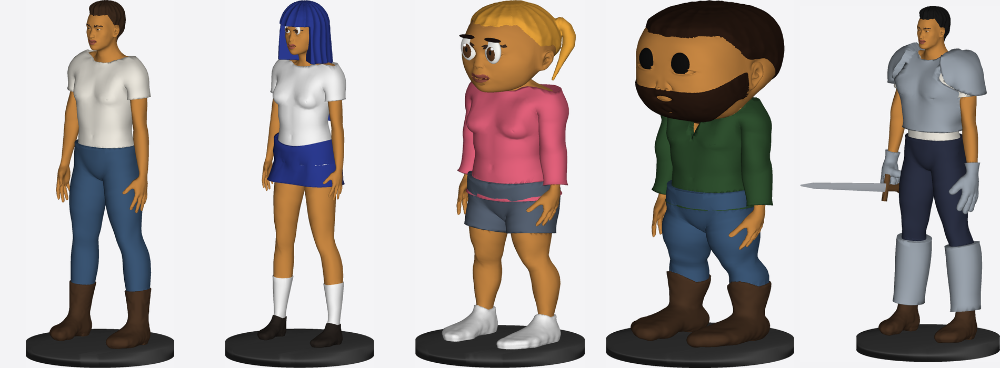
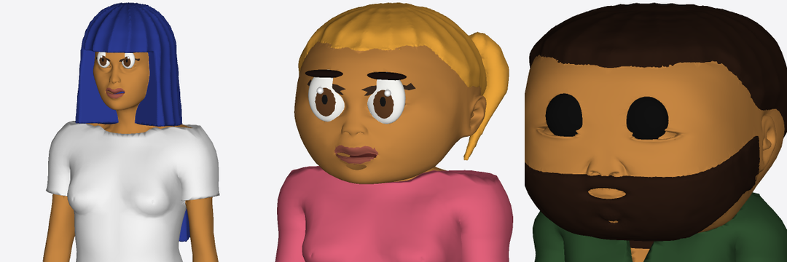

The same `api.human` call with `style: 'realistic' | 'anime' | 'chibi' | 'funko' | 'heroic'` — hair, clothing, footwear and props follow every style. Each is one manifold component (headless `model:preview` renders, 93k–135k triangles).

Sculpted eyes (anime: white, iris, pupil, highlight, lash line; toy: one black bead) and the smoothed, simplified heads:

