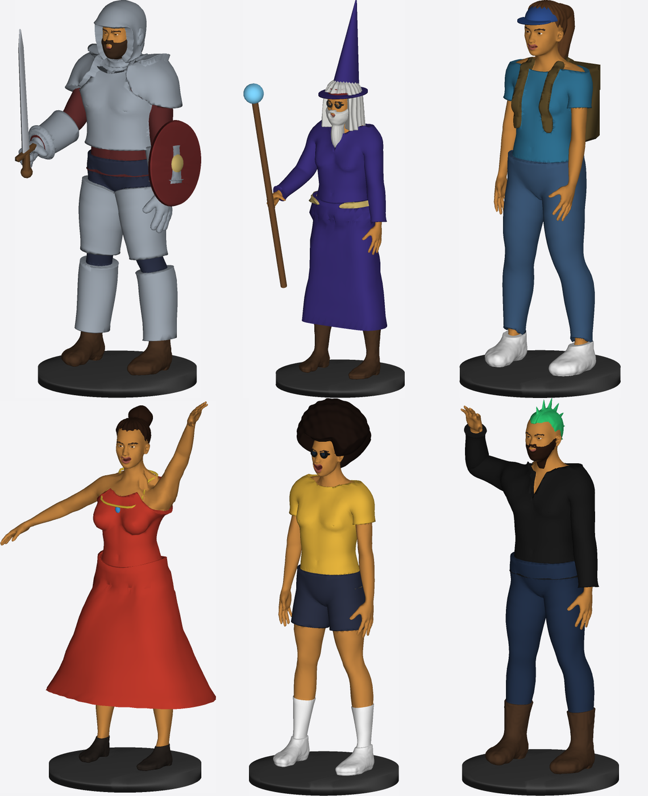
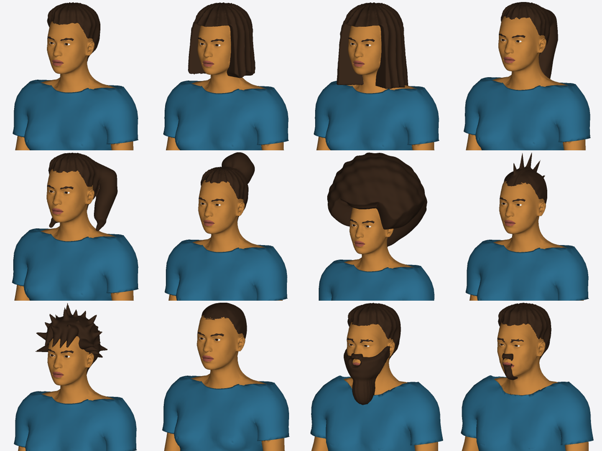
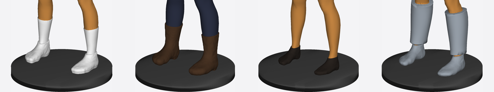

Six dressed figures — clothing, plate armor, footwear, hair, beards, held props, hats and a draped necklace. Each is one manifold component with a paint label per piece (headless `model:preview` renders).

Hair styles and beards (short, bob, long, ponytail, pigtails, bun, afro, mohawk, spiky, buzz, full beard, goatee):

Footwear is moulded over a closed foot (toes merged into a toe box, sole, heel): sneakers over socks, boots over trousers, shoes, sabatons under greaves.

