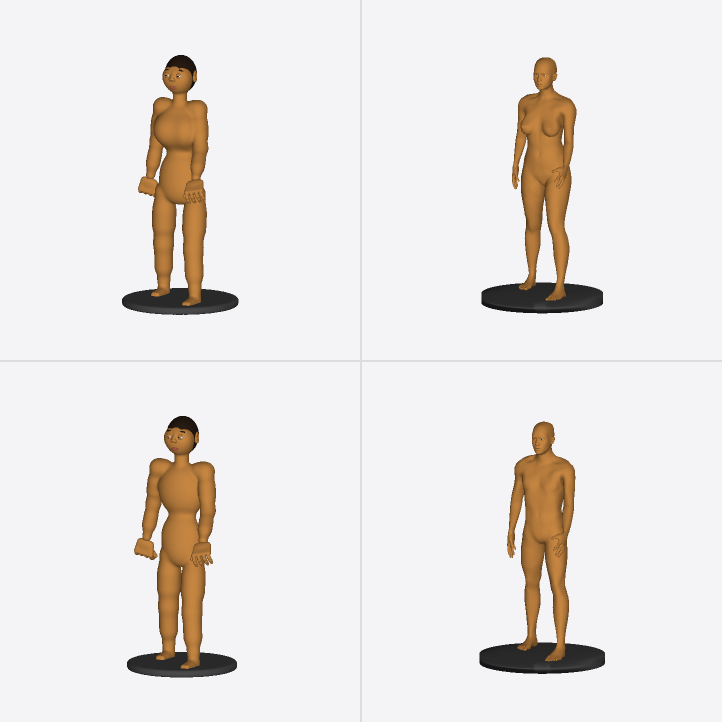
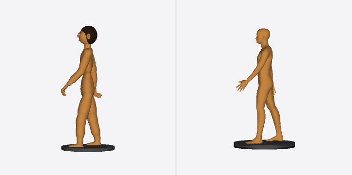
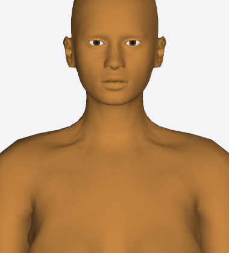
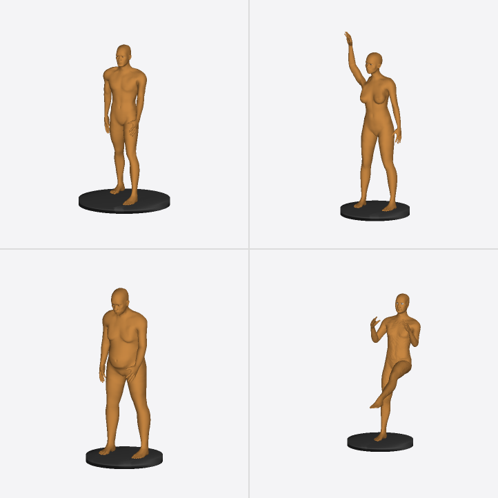
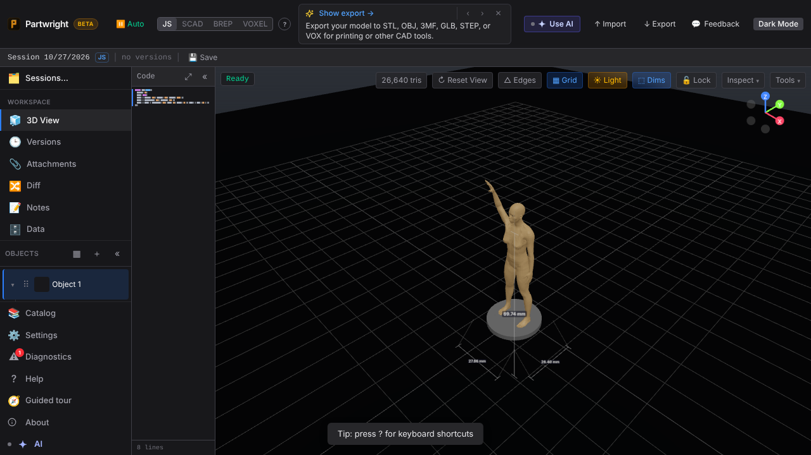

**Same body settings and pose: current SDF figure (left) vs `api.human` (right).** Female top row, male bottom.

| Front 3/4 | Side (same walking pose) |
|---|---|
|  |  |

| Face at print scale (native crop of a 2400 px render) | Morphs + poses: muscular walk, waving woman, older/heavier, kick with `weld: 'voxel'` |
|---|---|
|  |  |

**In the editor** (model code runs in the locked-down engine Worker; asset lazy-loads on first use):

