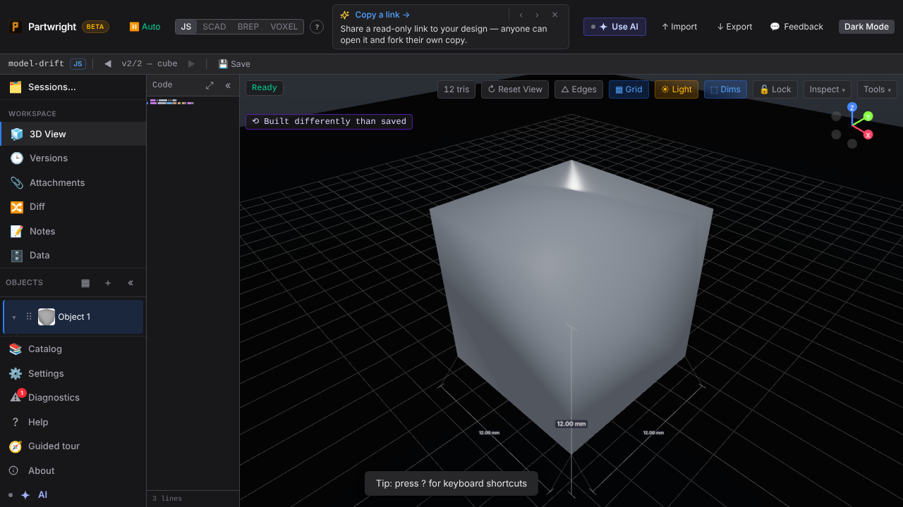
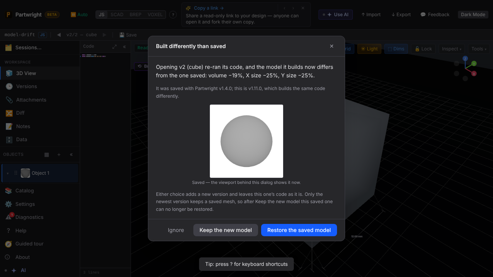
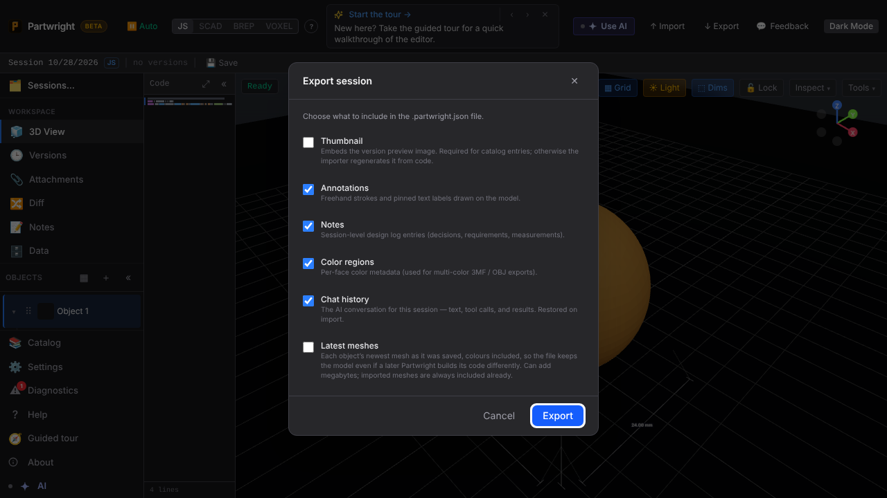

A saved version whose code now builds a different model gets a **⟲ Built differently than saved** pill. Simulated here: v2's code builds a cube, but it was saved (with "v1.4.0") as a sphere.

| Pill | Dialog: saved thumbnail, restore / keep / ignore |
|---|---|
|  |  |

The session export dialog gains **Latest meshes** (off by default):

