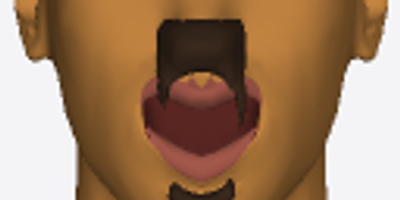
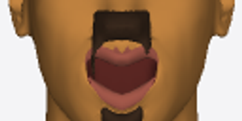
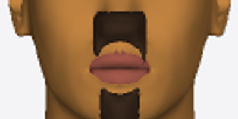

`api.human({ body: { gender: 1 }, expression: 'laugh', hair: { style: 'short', beard: 'goatee' } })`, front view, zoomed on the mouth.

| Before (main) | After (this PR) | Neutral face (reference) |
|---|---|---|
|  |  |  |

Before, the lifted upper lip splits the mustache into two thin drips. After, the mustache keeps its neutral shape, carried onto the smile.
