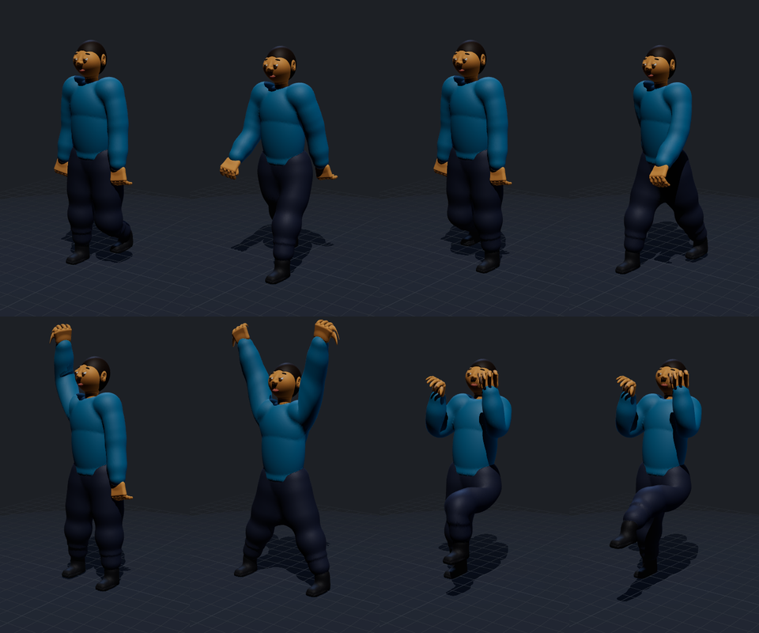
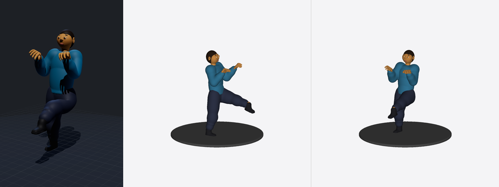
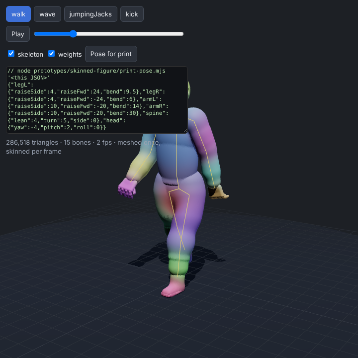

Prototype only, nothing changes in the app. These are the skinned preview and the printable rebuilds.

**Skinned frames** (mesh built once, deformed every frame by the rig): walk ×4, wave, jumping jacks, kick ×2

| Kick frame: skinned preview → printable SDF rebuild (manifold, 1 piece) | Bone-weight view + skeleton + "Pose for print" |
|---|---|
|  |  |
