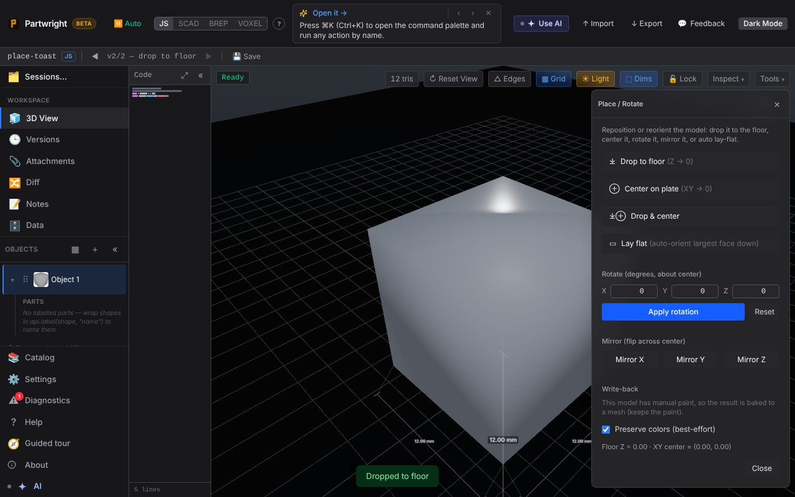
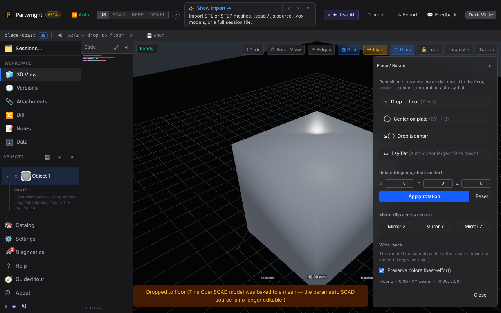

Place → **Drop to floor** on an OpenSCAD model bakes it to a mesh. Before, the toast said only "Dropped to floor", so losing the editable SCAD source went unmentioned. Now the toast says so, once.

| Before (#1136 head) | After (this PR) |
|---|---|
|  |  |
