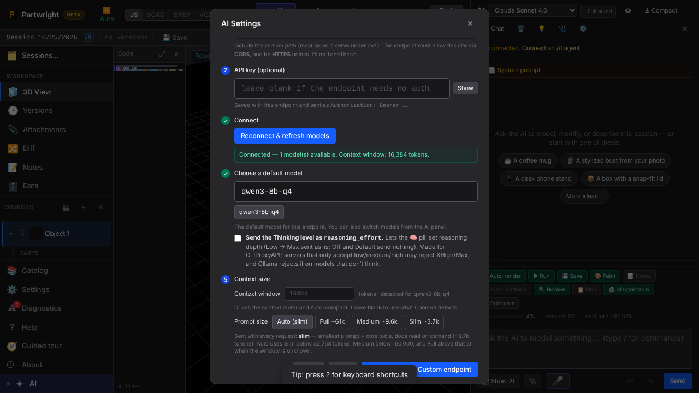
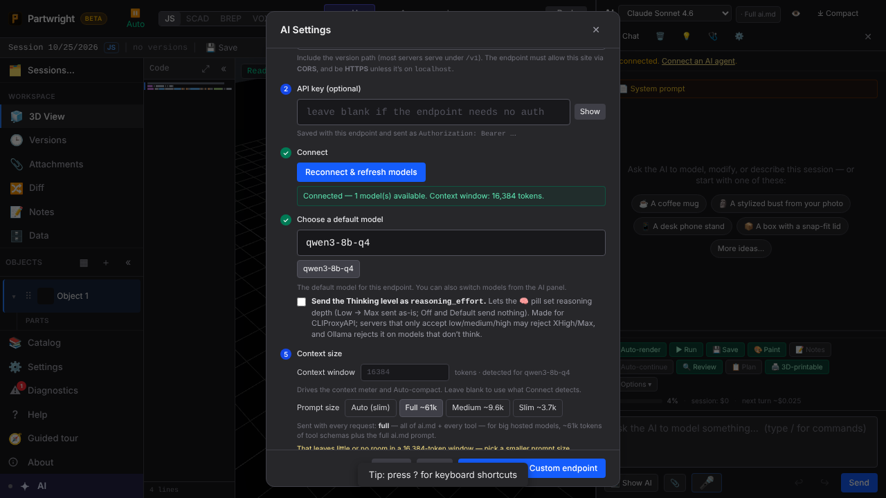
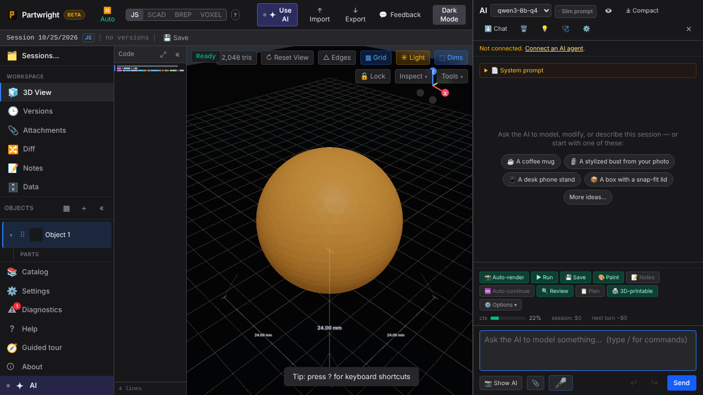

New **Context size** step on AI settings → Custom (OpenAI). Connect detects llama.cpp's 16k window from `/props`, Auto picks **Slim**, and choosing Full on that window warns.

| Detected → Auto (slim) | Full on a 16k window warns |
|---|---|
|  |  |

After activating: the panel's prompt chip says **Slim prompt**, and the context meter uses the real 16k window.

